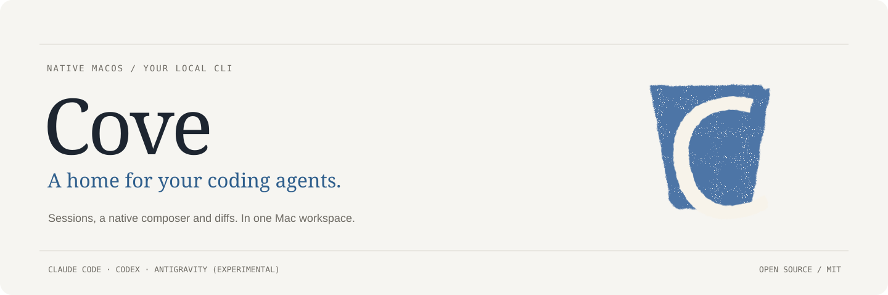
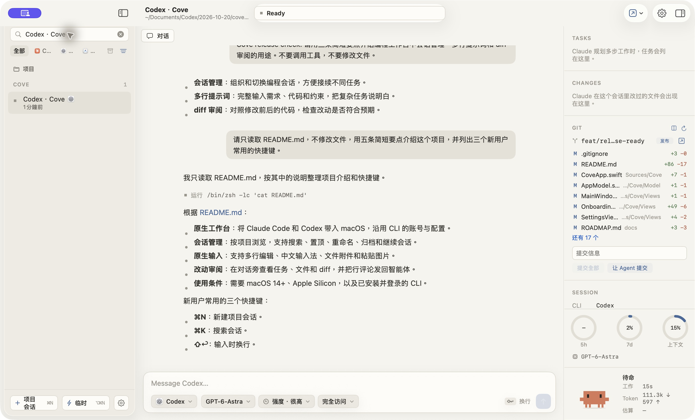

<p align="center"></p>

<p align="center">
  <strong><a href="https://github.com/huyanxius/Cove/releases/latest/download/Cove-macOS-arm64.dmg">下载 Mac 版 ↓</a></strong>
  &nbsp; · &nbsp; <a href="README.md">English</a>
  &nbsp; · &nbsp; <a href="docs/INSTALL.md">安装与排错</a>
  &nbsp; · &nbsp; <a href="https://github.com/huyanxius/Cove/issues/new/choose">反馈问题</a>
</p>

Cove 给 **Claude Code 和 Codex** 加上一个 macOS 原生工作台。在侧栏找回会话，用普通 Mac 输入框写提示词，在对话旁边审阅改动。底下运行的仍是你安装的 CLI，沿用它的账号、配置和模型服务。

<p align="center"></p>

## 开始使用

1. **准备 CLI。** 在终端安装并登录 [Claude Code](https://code.claude.com/docs/en/setup) 或 [Codex](https://developers.openai.com/codex/cli/)，确认能正常对话。
2. **安装 Cove。** [下载 DMG](https://github.com/huyanxius/Cove/releases/latest/download/Cove-macOS-arm64.dmg)，打开后把 **Cove.app 拖到「应用程序」**。也可以[下载 ZIP](https://github.com/huyanxius/Cove/releases/latest/download/Cove-macOS-arm64.zip)解压安装。
3. **选择项目。** 首次引导会检测已安装的 CLI，选择一个工具后，按 **⌘N** 选择项目文件夹，或按 **⌥⌘N** 新建临时会话。

**首次打开：** 预览版只有本地签名，**尚未经过 Apple 公证**。如果 macOS 拦截，先尝试打开一次，再到「系统设置 → 隐私与安全性 → 仍要打开」按提示确认。[Apple 说明](https://support.apple.com/zh-cn/102445) · [安装排错](docs/INSTALL.md)。

需要 **macOS 14+ 和 Apple Silicon**。当前界面主要为中文。Cove 不包含 CLI、模型或订阅，暂不支持自动更新。

## 主要功能

| | 用法 |
| :--- | :--- |
| **会话管理** | 按项目浏览，搜索标题，置顶、改名、归档，点开继续已有会话。 |
| **原生输入框** | 多行编辑、鼠标选区、撤销、中文输入法、文件附件与粘贴图片。 |
| **四档界面** | 保留原生终端、增加 Cove 输入框、替代 CLI 输入区，或使用原生对话界面。 |
| **改动审阅** | 查看任务、改动文件和 diff，把行内评论发回当前会话。 |
| **Git 与 GitHub** | 查看分支和工作区状态，提交、拉取、推送；通过已登录的 `gh` 查看 PR 检查。 |
| **用量与状态** | 展示 CLI 实际提供的模型、上下文、Token 和额度，小螃蟹跟随 Agent 状态变化。 |

Claude 会话还支持独立 Git 工作树、转录备份，以及从原始转录复制上一条回复。

| Agent | 终端档位 | 原生对话 | 说明 |
| :--- | :---: | :---: | :--- |
| **Claude Code** | 支持 | 支持 | 工具活动、权限确认、恢复会话与可用用量。 |
| **Codex** | 支持 | 支持 | 通过 app-server 接入，支持权限确认、会话 Token 与可用额度；不支持的服务端请求会明确提示。 |
| **Antigravity（`agy`）** | 支持 | 实验性 | 对话档位暂不支持审批、打断和恢复后的历史消息展示。 |

**预览版问题：** 在已测试的 CLI 版本中，Cove 新建的 Codex 会话关闭后未能重新出现在侧栏，正在 [#5](https://github.com/huyanxius/Cove/issues/5) 跟进。

用量取决于 CLI 与界面档位，缺失数据不代表用量为零。按 API 单价估算的花费不代表订阅实际支出。其他边界见[已知限制](docs/KNOWN_LIMITATIONS.md)。

## 常用快捷键

| 快捷键 | 操作 |
| :--- | :--- |
| ⌘N / ⌥⌘N | 新建项目会话 / 临时会话 |
| ⇧⌘N | 在独立 Git 工作树中新建 Claude 会话 |
| ⌘K / ⌘L | 搜索会话 / 聚焦输入框 |
| ⌘/ | 切换 CLI 输入与 Cove 输入 |
| ⌥⌘I | 显示或隐藏检查器 |
| ⇧⌘C | 从转录复制上一条 Claude 回复 |
| ↩ / ⇧↩ | 发送 / 换行 |
| 连按两次 Esc | 打断支持此操作的原生对话 |

## 数据与权限

Cove 读取本机的 CLI 会话索引，通过登录 shell 启动 Agent。账号、环境变量、工具权限和服务提供方沿用 CLI 配置。Claude 的额外配置只通过当前进程的 `--settings` 叠加，不修改全局 `~/.claude/settings.json`。

转录备份与协议日志保存在 `~/Library/Application Support/Cove/`，备份可在设置中关闭。日志可能含提示词与工具输出，分享前请检查并删去私密内容。Agent 请求仍发往 CLI 配置的服务。

## 源码与贡献

安装 Swift 6 工具链后：

```sh
git clone https://github.com/huyanxius/Cove.git
cd Cove
scripts/bundle.sh
open build/Cove.app
```

开发版打包、定向测试与贡献流程见 [CONTRIBUTING.md](CONTRIBUTING.md)。Intel Mac 的源码构建尚未验证。

[路线图](docs/ROADMAP.md) · [设计语言](docs/DESIGN.md) · [发布流程](docs/RELEASING.md) · [安全反馈](SECURITY.md)

Cove 是采用 [MIT 协议](LICENSE)的独立项目，终端使用同为 MIT 协议的 [SwiftTerm](https://github.com/migueldeicaza/SwiftTerm)。
