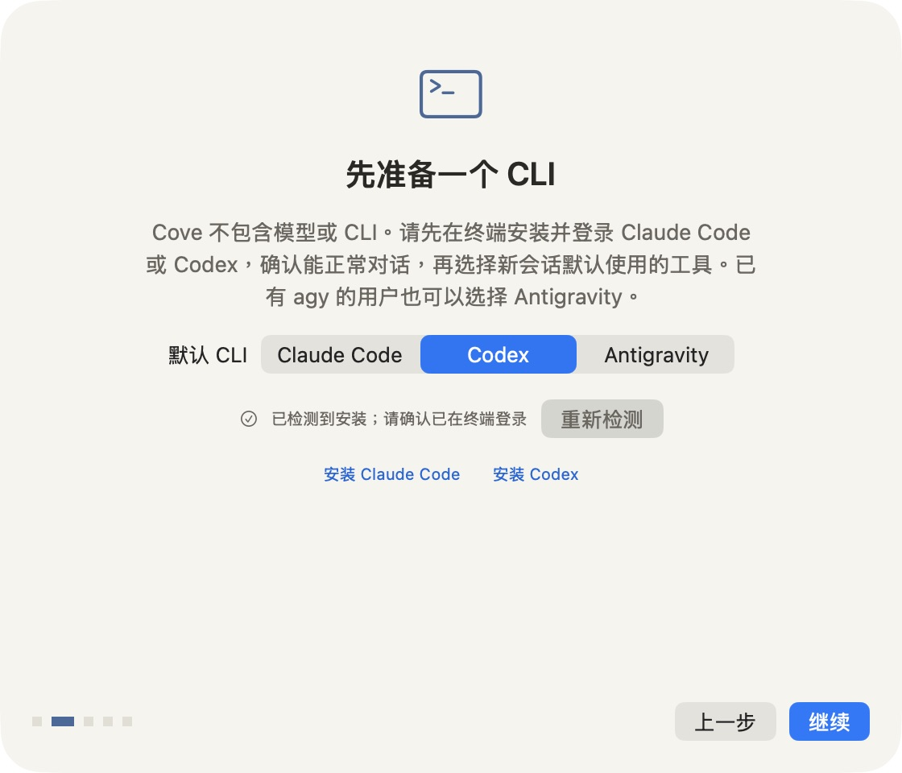

# Install Cove

Download [Cove for Apple Silicon](https://github.com/huyanxius/Cove/releases/latest/download/Cove-macOS-arm64.dmg), open the DMG, and drag **Cove.app** to **Applications**. Open it from Applications. macOS 14 or later is required.

Install and sign in to [Claude Code](https://code.claude.com/docs/en/setup) or [Codex](https://developers.openai.com/codex/cli/) in Terminal first. Cove detects commands in your login shell, including PATH entries and aliases. Detection checks that the command can report its version; it does not verify login or account access.

<p align="center"></p>

## macOS blocks the first launch

The preview has an ad-hoc signature and has not been notarized by Apple. Attempt to open Cove once, then go to **System Settings → Privacy & Security → Open Anyway** and follow the system's prompts. See [Apple's instructions](https://support.apple.com/en-us/102445).

Download only from this repository's Releases. `SHA256SUMS.txt` is included with each release. To check downloaded assets in Terminal, place it beside the DMG or ZIP and run:

```sh
shasum -a 256 Cove-macOS-arm64.dmg
```

Compare the result with the DMG entry in `SHA256SUMS.txt`. A matching checksum confirms the file matches that release's asset; it does not provide Apple notarization.

## The CLI is not detected

1. Confirm `claude`, `codex`, or `agy` works in a new Terminal window.
2. Finish the CLI's own installation and login steps.
3. In onboarding, click **重新检测**. Cove automatically selects an installed alternative when the current choice is unavailable.
4. If detection still fails, check whether your login-shell configuration waits for interactive input or prints an error. The check has a six-second timeout.

If an alias wraps your CLI, it must accept the CLI's normal arguments. Use terminal mode for CLI-specific interactive menus.

## A project cannot be opened

Choose it through **⌘N**. If macOS denies access to Desktop or Documents, allow Cove in **System Settings → Privacy & Security → Files and Folders** where available, then reopen the session. The onboarding page also links to Full Disk Access for setups that need it. Start with an accessible project folder to isolate permission problems.

## A native conversation fails

Check the same CLI in Terminal first. Include the CLI version and Cove interface mode in a [bug report](https://github.com/huyanxius/Cove/issues/new?template=bug_report.md). Switch to a terminal mode in Settings if you need a CLI-only panel.

Protocol logs are stored at `~/Library/Application Support/Cove/logs/`. They may contain prompts, paths, and tool output. Redact private content before sharing.

## Update or remove Cove

Quit Cove, download a newer release, and replace the app in Applications. There is no automatic updater yet. Remove the app from Applications to uninstall it. Preferences, backups, and logs remain in your Library; your CLI installation and its accounts are separate.

## 中文快速说明

下载 DMG，将应用拖到「应用程序」。先在终端安装并登录 Claude Code 或 Codex，再打开 Cove。引导会检测已安装工具，安装后可点「重新检测」。

预览版尚未公证。如被系统拦截，尝试打开一次后，到「系统设置 → 隐私与安全性 → 仍要打开」确认。文件夹访问失败时，允许相应权限后重开会话。更新时先退出 Cove，再替换应用。
